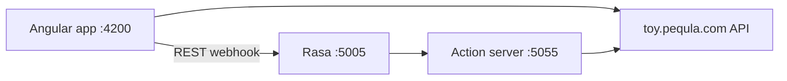

# Toy Store with a Rasa Assistant

An Angular toy store with a chatbot that recommends and searches for toys. Exam project for the *Human-Computer Interaction* course at Singidunum University. It shares its store front end with my [Client-side Web Applications project](https://github.com/veljko-milisavljevic/KVA-ispit) and adds the assistant.

## Features

- Catalog with search and filters, toy details, sign up and login.
- Reservations with quantity, simulated payment, cancellation, rating and an order total.
- Chat widget backed by Rasa, with two custom actions:
  - `action_latest_toys` returns the last three toys from the API.
  - `action_search_toys` searches names, descriptions and categories.

The store UI and the bot's toy replies are in Serbian. The bot is trained on English phrases, for example "recommend something fun" or "find lego".

## Architecture



## Tech stack

- Angular 21, TypeScript, Axios, Bootstrap 5
- Rasa 3.6.21, Python 3.10, Rasa SDK

## Getting started

### Prerequisites

- [Git](https://git-scm.com/downloads)
- [Node.js](https://nodejs.org/en/download) 20.19+, 22.12+ or 24+
- Python 3.10. Rasa 3.6 does not support newer versions, so if your system has one, use [pyenv](https://github.com/pyenv/pyenv#installation).

### Installation

The repository is about 250 MB, because it includes trained models.

```bash
git clone https://github.com/veljko-milisavljevic/ICR-Ispit.git
cd ICR-Ispit
npm install
```

Create the Python environment with pyenv:

```bash
cd chatbot
pyenv install --skip-existing 3.10.14
PYENV_VERSION=3.10.14 pyenv exec python -m venv .venv
source .venv/bin/activate
pip install rasa==3.6.21
```

If you already have Python 3.10, replace the two pyenv commands with `python3.10 -m venv .venv`.

### Running

Run each part in its own terminal, starting from the repository root.

**1. Train and start Rasa**

```bash
cd chatbot
source .venv/bin/activate
rasa train
rasa run --enable-api --cors "http://localhost:4200"
```

**2. Start the action server**

```bash
cd chatbot
source .venv/bin/activate
rasa run actions
```

**3. Start the web app**

```bash
npm start
```

Open http://localhost:4200. The login form is prefilled with a demo account (`korisnik@primer.com` / `user123`).

## Limitations

- Users, passwords and reservations are stored unencrypted in `localStorage`, and payment is simulated.
- Almost all search training examples use "lego", so other search terms are recognized less reliably.
- The chat does not handle connection errors: if Rasa is down, the "thinking" message stays on screen.
- The About page is a placeholder.

## Author

[Veljko Milisavljević](https://github.com/veljko-milisavljevic)
